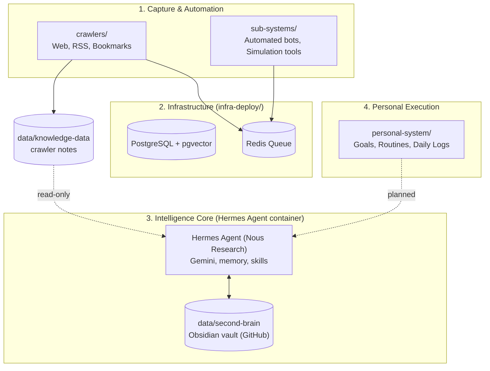

# 🧠 Personal Life Manager (Second Brain)

A modular, automated **Second Brain** platform designed to capture external knowledge, synthesize insights using AI, track personal goals and routines, and automate background tasks.

---

## 🏗️ Architecture Overview



---

## 📂 Repository Structure

| Module | Description | Quick Link |
| :--- | :--- | :--- |
| **`crawlers/`** | Web scrapers, RSS ingestion, bookmark synchronizers, and content fetchers. | [Explore Crawlers](file:///home/vitor/workspace/personal/personal-life-manager/crawlers/README.md) |
| **`documentation/`** | System architecture, data flow diagrams, and Second Brain methodology. | [View Docs](file:///home/vitor/workspace/personal/personal-life-manager/documentation/README.md) |
| **`infra-deploy/`** | Docker Compose configurations (Postgres/pgvector, Redis), environment templates, and deployment scripts. | [View Deploy Specs](file:///home/vitor/workspace/personal/personal-life-manager/infra-deploy/README.md) |
| **`personal-system/`** | Full-stack platform (Golang API + Next.js UI) to administer time, tasks, and servers, plus goals and routines. | [View Personal System](file:///home/vitor/workspace/personal/personal-life-manager/personal-system/README.md) |
| **`sub-systems/`** | Standalone sub-systems, automated bots, and game tools (`auto-players`, `satisfatory-plan`). | [Explore Sub-Systems](file:///home/vitor/workspace/personal/personal-life-manager/sub-systems/README.md) |
| **`scripts/`** | Helper scripts (e.g. syncing Obsidian Second Brain GitHub repository). | [Explore Scripts](file:///home/vitor/workspace/personal/personal-life-manager/scripts/README.md) |
| **`data/`** *(gitignored)* | Local data: `second-brain/` (clone of the Obsidian vault), `knowledge-data/` (crawler output, Dropbox only) and `database/` (SQLite files, Hermes Agent state in `hermes-mds/`). | `second-brain/` synced via `./scripts/download_brain.sh` |

---

## ⚡ Quickstart

### 1. Prerequisites
- Podman & Podman Compose (or Docker Compose)
- Git

### 2. Configure Environment & Sync Obsidian Database
```bash
# Copy and configure environment variables
cp .env.example .env

# Clone or pull your Obsidian Second Brain into data/second-brain/
./scripts/download_brain.sh
```

### 3. Run Everything with Podman
```bash
# Launch PostgreSQL, Redis, Golang backend, and Next.js frontend
podman-compose up -d

# Check running status
podman-compose ps
```

Access the dashboard at [http://localhost:3000](http://localhost:3000) and API at [http://localhost:8080](http://localhost:8080).

### 4. Hermes Agent (AI over your second brain)
[Hermes Agent](https://github.com/NousResearch/hermes-agent) by Nous Research runs as the `hermes`
service, using the official image. It reads and writes the vault in `data/second-brain/` (mounted at
`/vault`) and can read the crawler notes in `data/knowledge-data/` (mounted read-only at `/knowledge`).
Its own state (config, memory, sessions, skills) lives in `data/database/hermes-mds/` and goes to
Dropbox with `./scripts/sync_dropbox.sh`. The model is Gemini, using `GEMINI_API_KEY` from `.env`;
the key is passed as an environment variable and never stored in `hermes-mds/`.

```bash
podman-compose up -d hermes                               # start it
podman exec -it hermes hermes       # chat in the terminal
podman-compose stop hermes                                # stop it before syncing Dropbox
git -C data/second-brain diff                             # review its edits before committing
```

To chat from Telegram, create a bot with [@BotFather](https://t.me/BotFather) (`/newbot`), get your
numeric user ID from [@userinfobot](https://t.me/userinfobot), set `TELEGRAM_BOT_TOKEN` and
`TELEGRAM_ALLOWED_USERS` in `.env` and restart with `podman-compose up -d hermes`. It uses polling,
so no port has to be opened.

To let it manage Notion, create an internal integration at
[notion.so/my-integrations](https://notion.so/my-integrations), set `NOTION_API_KEY` in `.env`,
share the pages or databases it may use with the integration (page menu → **Connect to**) and
restart with `podman-compose up -d hermes`.

The dashboard is at [http://localhost:9119](http://localhost:9119) (this machine only). The model
is set in `data/database/hermes-mds/config.yaml`.

### 5. SilverBullet: the vault in the browser
The `silverbullet` service runs [SilverBullet](https://silverbullet.md), a web Markdown editor, over
`data/second-brain/`, so you and Hermes edit the same notes. It understands `[[wikilinks]]` like
Obsidian; Obsidian-only plugins and syntax (Dataview, callouts) are not rendered the same way.

```bash
podman-compose up -d silverbullet
```

On start, the one-shot `silverbullet-libs` service runs `scripts/silverbullet-libs.sh`, which installs
the pinned libraries (Mermaid, LaTeX Math, Silversearch, PDF Viewer, Markdown Prettify, Excalidraw,
Basic Search) and the TreeView plug into the vault's `Library/` when they are missing. To update one,
bump its URL in the script and delete its page in `Library/` (or update it from SilverBullet's
Library Manager). The vault's `.gitignore` versions `Library/` whole, so a fresh clone works offline.

Open [http://localhost:3010](http://localhost:3010). It is bound to localhost only; to reach it from
another machine, use an SSH tunnel (`ssh -N -L 3010:localhost:3010 <host>`). For the full Obsidian
app, install it on each computer and open the vault (or a clone of its repository) directly.

---

## 📖 Key Documentation
- [System Architecture](file:///home/vitor/workspace/personal/personal-life-manager/documentation/architecture.md)
- [Second Brain Methodology](file:///home/vitor/workspace/personal/personal-life-manager/documentation/methodology.md)
- [Agent & Contributor Guide (AGENTS.md)](file:///home/vitor/workspace/personal/personal-life-manager/AGENTS.md)