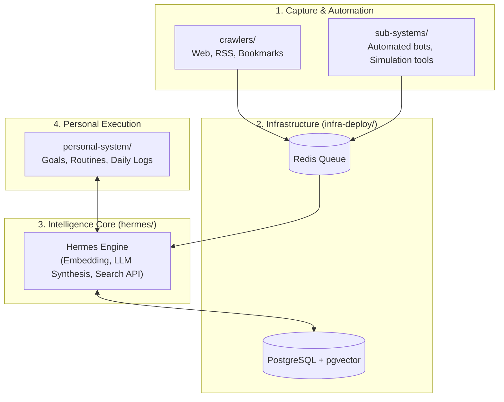

# 🧠 Personal Life Manager (Second Brain)

A modular, automated **Second Brain** platform designed to capture external knowledge, synthesize insights using AI, track personal goals and routines, and automate background tasks.

---

## 🏗️ Architecture Overview



---

## 📂 Repository Structure

| Module | Description | Quick Link |
| :--- | :--- | :--- |
| **`crawlers/`** | Web scrapers, RSS ingestion, bookmark synchronizers, and content fetchers. | [Explore Crawlers](file:///home/vitor/workspace/personal/personal-life-manager/crawlers/README.md) |
| **`documentation/`** | System architecture, data flow diagrams, and Second Brain methodology. | [View Docs](file:///home/vitor/workspace/personal/personal-life-manager/documentation/README.md) |
| **`hermes/`** | Core engine: LLM orchestration, semantic search, vector indexing, and assistant API. | [Explore Hermes](file:///home/vitor/workspace/personal/personal-life-manager/hermes/README.md) |
| **`infra-deploy/`** | Docker Compose configurations (Postgres/pgvector, Redis), environment templates, and deployment scripts. | [View Deploy Specs](file:///home/vitor/workspace/personal/personal-life-manager/infra-deploy/README.md) |
| **`personal-system/`** | Full-stack platform (Golang API + Next.js UI) to administer time, tasks, and servers, plus goals and routines. | [View Personal System](file:///home/vitor/workspace/personal/personal-life-manager/personal-system/README.md) |
| **`sub-systems/`** | Standalone sub-systems, automated bots, and game tools (`auto-players`, `satisfatory-plan`). | [Explore Sub-Systems](file:///home/vitor/workspace/personal/personal-life-manager/sub-systems/README.md) |
| **`scripts/`** | Helper scripts (e.g. syncing Obsidian Second Brain GitHub repository). | [Explore Scripts](file:///home/vitor/workspace/personal/personal-life-manager/scripts/README.md) |
| **`data/`** *(gitignored)* | Local data: `second-brain/` (clone of the Obsidian vault), `knowledge-data/` (crawler output) and `database/` (SQLite files). | `second-brain/` synced via `./scripts/download_brain.sh` |

---

## ⚡ Quickstart

### 1. Prerequisites
- Podman & Podman Compose (or Docker Compose)
- Git

### 2. Configure Environment & Sync Obsidian Database
```bash
# Copy and configure environment variables
cp .env.example .env

# Clone or pull your Obsidian Second Brain into data/second-brain/
./scripts/download_brain.sh
```

### 3. Run Everything with Podman
```bash
# Launch PostgreSQL, Redis, Golang backend, and Next.js frontend
podman-compose up -d

# Check running status
podman-compose ps
```

Access the dashboard at [http://localhost:3000](http://localhost:3000) and API at [http://localhost:8080](http://localhost:8080).

---

## 📖 Key Documentation
- [System Architecture](file:///home/vitor/workspace/personal/personal-life-manager/documentation/architecture.md)
- [Second Brain Methodology](file:///home/vitor/workspace/personal/personal-life-manager/documentation/methodology.md)
- [Agent & Contributor Guide (AGENTS.md)](file:///home/vitor/workspace/personal/personal-life-manager/AGENTS.md)