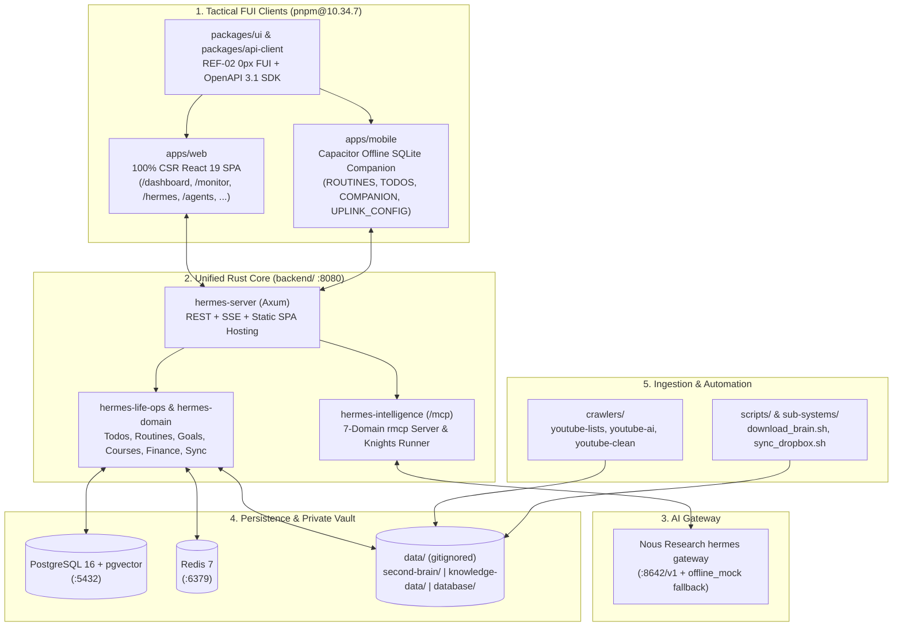

# 🧠 `HERMES // OS` — Personal Life Manager (Second Brain)

A personal daily-driver **Second Brain & Life Operations** system combining a multi-crate **Rust** backend (`Axum` + `SQLx` + `pgvector` + `/mcp`), a 100% client-rendered **React 19 Tactical FUI Web SPA**, an offline-first **Capacitor SQLite Mobile Companion**, Nous Research **`hermes gateway`** intelligence, and automated **Python crawlers**.

---

## 🏗️ Ecosystem Architecture



---

## 📂 Repository Structure

| Module | Description | Quick Link |
| :--- | :--- | :--- |
| **`backend/`** | Multi-crate Rust 2024 workspace (`domain`, `life-ops`, `intelligence`, `server`) serving `/api/*`, `/mcp`, and `apps/web/dist`. | [Contributor Guide](./AGENTS.md) |
| **`packages/`** | `@hermes/ui` (`REF-02` `0px` Tactical FUI components, HUD loaders, charts, pixel-art sprites) & `@hermes/api-client` (OpenAPI 3.1 SDK). | [Architecture Spec](./systems-requirements/01-architecture-and-tech-stack.md) |
| **`apps/web/`** | 100% client-rendered Vite + React 19 Web SPA across Modules `03`–`11` (`/dashboard`, `/monitor`, `/hermes`, `/agents`, `/todos`, `/routines`, `/goals`, `/courses`, `/finance`). | [System Specs](./systems-requirements/README.md) |
| **`apps/mobile/`** | Capacitor + Vite React CSR offline-first mobile companion scoped strictly to `ROUTINES`, `TODOS`, `COMPANION`, and `UPLINK_CONFIG`. | [Companion Spec](./systems-requirements/02-companion-app.md) |
| **`crawlers/`** | Python ingestion tools (`youtube-lists`, `youtube-ai`, `youtube-clean`) and standardized crawler templates. | [Explore Crawlers](./crawlers/README.md) |
| **`infra-deploy/`** | Multi-stage `Dockerfile`, Podman/Docker Compose manifests (`pgvector:pg16`, `redis:7-alpine`, `hermes-server`), and `initdb/`. | [View Deploy Specs](./infra-deploy/README.md) |
| **`scripts/`** | Automation helpers for Obsidian vault sync (`download_brain.sh`), Dropbox rclone sync (`sync_dropbox.sh`), and git secret hooks. | [Explore Scripts](./scripts/README.md) |
| **`sub-systems/`** | Standalone sub-systems, automated bots, and simulation tools (`auto-players`, `satisfatory-plan`). | [Explore Sub-Systems](./sub-systems/README.md) |
| **`documentation/`** | Conceptual architecture overview and Second Brain CODE methodology notes. | [View Docs](./documentation/README.md) |
| **`data/`** *(gitignored)* | Zero-tracked local storage: `second-brain/` (Obsidian vault), `knowledge-data/` (crawler Markdown), and `database/` (crawler SQLite). | Synced via `./scripts/download_brain.sh` |

---

## ⚡ Quickstart

### Option A — Unified Container Stack (`Podman` / `Docker`)
```bash
# 1. Optional: copy environment overrides and sync your Obsidian Second Brain vault
cp .env.example .env
./scripts/download_brain.sh

# 2. Launch PostgreSQL 16 (pgvector), Redis 7, and unified hermes-server (:8080)
podman-compose up -d
podman-compose ps
```
Open **`http://localhost:8080`** for the Web SPA & REST/MCP server (`http://localhost:8080/api/health`).

### Option B — Local Development (`Cargo` + `Vite HMR` + `Podman DB/Redis`)
```bash
# 1. Start PostgreSQL 16 (pgvector) and Redis 7 containers
podman-compose up -d postgres redis

# 2. Install TypeScript workspace dependencies
corepack pnpm@10.34.7 install

# 3. Start Rust backend (:8080) and Vite Web SPA HMR dev server (:5173)
(cd backend && cargo run --bin server)
corepack pnpm@10.34.7 --filter @hermes/web dev
```
Open **`http://localhost:5173`** during active UI development (proxies `/api` and `/mcp` to `http://127.0.0.1:8080`).

---

## 📖 Key Documentation
- [Authoritative v1.0 Specifications & Visual Atlas](./systems-requirements/README.md)
- [Agent & Contributor Guide (`AGENTS.md`)](./AGENTS.md)
- [Claude Operational Summary (`CLAUDE.md`)](./CLAUDE.md)
- [System Architecture Overview](./documentation/architecture.md)
- [Second Brain CODE Methodology](./documentation/methodology.md)
