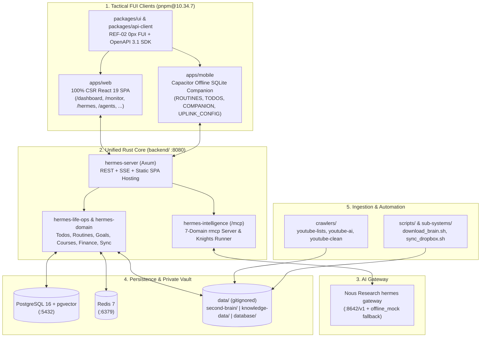

# 🧠 `HERMES // OS` — Personal Life Manager (Second Brain)

A personal daily-driver **Second Brain & Life Operations** system combining a multi-crate **Rust** backend (`Axum` + `SQLx` + `pgvector` + `/mcp`), a 100% client-rendered **React 19 Tactical FUI Web SPA**, an offline-first **Capacitor SQLite Mobile Companion**, Nous Research **`hermes gateway`** intelligence, and automated **Python crawlers**.

---

## 🏗️ Ecosystem Architecture



---

## 📂 Repository Structure

| Module | Description | Quick Link |
| :--- | :--- | :--- |
| **`life-manager/backend/`** | Multi-crate Rust 2024 workspace (`domain`, `life-ops`, `intelligence`, `server`) serving `/api/*`, `/mcp`, and `apps/web/dist`. | [Contributor Guide](./AGENTS.md) |
| **`life-manager/packages/`** | `@hermes/ui` (`REF-02` `0px` Tactical FUI components, HUD loaders, charts, pixel-art sprites) & `@hermes/api-client` (OpenAPI 3.1 SDK). | [Architecture Spec](./life-manager/systems-requirements/01-architecture-and-tech-stack.md) |
| **`life-manager/apps/web/`** | 100% client-rendered Vite + React 19 Web SPA across Modules `03`–`11` (`/dashboard`, `/monitor`, `/hermes`, `/agents`, `/todos`, `/routines`, `/goals`, `/courses`, `/finance`). | [System Specs](./life-manager/systems-requirements/README.md) |
| **`life-manager/apps/mobile/`** | Capacitor + Vite React CSR offline-first mobile companion scoped strictly to `ROUTINES`, `TODOS`, `COMPANION`, and `UPLINK_CONFIG`. | [Companion Spec](./life-manager/systems-requirements/02-companion-app.md) |
| **`crawlers/`** | Python ingestion tools (`youtube-lists`, `youtube-ai`, `youtube-clean`) and standardized crawler templates. | [Explore Crawlers](./crawlers/README.md) |
| **`life-manager/infra-deploy/`** | Multi-stage `Dockerfile` (built by podman), Podman Compose manifests (`pgvector:pg16`, `redis:7-alpine`, `hermes-server`), and `initdb/`. | [View Deploy Specs](./life-manager/infra-deploy/README.md) |
| **`scripts/`** | Automation helpers for Obsidian vault sync (`download_brain.sh`), Dropbox rclone sync (`sync_dropbox.sh`), and git secret hooks. | [Explore Scripts](./scripts/README.md) |
| **`sub-systems/`** | Standalone sub-systems, automated bots, and simulation tools (`auto-players`, `satisfatory-plan`). | [Explore Sub-Systems](./sub-systems/README.md) |
| **`documentation/`** | Conceptual architecture overview and Second Brain CODE methodology notes. | [View Docs](./documentation/README.md) |
| **`hermes`** / **`silverbullet`** *(services)* | Hermes Agent (Nous Research) gateway on `:8642` over the vault, and the SilverBullet web editor over the same vault on `127.0.0.1:3010`. Official images, not code in this repo. | [Hermes & SilverBullet](#hermes-agent--silverbullet) |
| **`data/`** *(gitignored)* | Zero-tracked local storage: `second-brain/` (Obsidian vault), `knowledge-data/` (crawler Markdown, Dropbox only), and `database/` (crawler SQLite, Hermes Agent state in `hermes-mds/`). | Synced via `./scripts/download_brain.sh` and `./scripts/sync_dropbox.sh` |

---

## ⚡ Quickstart

### Option A — Unified Container Stack (`Podman`)
```bash
# 1. Optional: copy environment overrides and sync your Obsidian Second Brain vault
cp .env.example .env
./scripts/download_brain.sh

# 2. Launch PostgreSQL 16 (pgvector), Redis 7, and unified hermes-server (:8080)
podman-compose up -d
podman-compose ps
```
Open **`http://localhost:8080`** for the Web SPA & REST/MCP server (`http://localhost:8080/api/health`).

### Option B — Local Development (`Cargo` + `Vite HMR` + `Podman DB/Redis`)
```bash
# 1. Start PostgreSQL 16 (pgvector) and Redis 7 containers
podman-compose up -d postgres redis

# 2. Install TypeScript workspace dependencies
corepack pnpm@10.34.7 install

# 3. Start Rust backend (:8080) and Vite Web SPA HMR dev server (:5173)
(cd backend && cargo run --bin server)
corepack pnpm@10.34.7 --filter @hermes/web dev
```
Open **`http://localhost:5173`** during active UI development (proxies `/api` and `/mcp` to `http://127.0.0.1:8080`).

### Hermes Agent & SilverBullet
[Hermes Agent](https://github.com/NousResearch/hermes-agent) by Nous Research runs as the `hermes`
service, using the official image. It reads and writes the vault in `data/second-brain/` (mounted at
`/vault`) and can read the crawler notes in `data/knowledge-data/` (mounted read-only at `/knowledge`).
Its own state (config, memory, sessions, skills) lives in `data/database/hermes-mds/` and goes to
Dropbox with `./scripts/sync_dropbox.sh`. The model is Gemini, using `GEMINI_API_KEY` from `.env`;
the key is passed as an environment variable and never stored in `hermes-mds/`.

```bash
podman-compose up -d hermes                               # start it
podman exec -it hermes hermes       # chat in the terminal
podman-compose stop hermes                                # stop it before syncing Dropbox
git -C data/second-brain diff                             # review its edits before committing
```

To chat from Telegram, create a bot with [@BotFather](https://t.me/BotFather) (`/newbot`), get your
numeric user ID from [@userinfobot](https://t.me/userinfobot), set `TELEGRAM_BOT_TOKEN` and
`TELEGRAM_ALLOWED_USERS` in `.env` and restart with `podman-compose up -d hermes`. It uses polling,
so no port has to be opened.

To let it manage Notion, create an internal integration at
[notion.so/my-integrations](https://notion.so/my-integrations), set `NOTION_API_KEY` in `.env`,
share the pages or databases it may use with the integration (page menu → **Connect to**) and
restart with `podman-compose up -d hermes`.

The dashboard is at [http://localhost:9119](http://localhost:9119) (this machine only). The model
is set in `data/database/hermes-mds/config.yaml`.

#### SilverBullet: the vault in the browser
The `silverbullet` service runs [SilverBullet](https://silverbullet.md), a web Markdown editor, over
`data/second-brain/`, so you and Hermes edit the same notes. It understands `[[wikilinks]]` like
Obsidian; Obsidian-only plugins and syntax (Dataview, callouts) are not rendered the same way.

```bash
podman-compose up -d silverbullet
```

On start, the one-shot `silverbullet-libs` service runs `scripts/silverbullet-libs.sh`, which installs
the pinned libraries (Mermaid, LaTeX Math, Silversearch, PDF Viewer, Markdown Prettify, Excalidraw,
Basic Search) and the TreeView plug into the vault's `Library/` when they are missing. To update one,
bump its URL in the script and delete its page in `Library/` (or update it from SilverBullet's
Library Manager). The vault's `.gitignore` versions `Library/` whole, so a fresh clone works offline.

Open [http://localhost:3010](http://localhost:3010). It is bound to localhost only; to reach it from
another machine, use an SSH tunnel (`ssh -N -L 3010:localhost:3010 <host>`). For the full Obsidian
app, install it on each computer and open the vault (or a clone of its repository) directly.

---

## 📖 Key Documentation
- [Authoritative v1.0 Specifications & Visual Atlas](./life-manager/systems-requirements/README.md)
- [Agent & Contributor Guide (`AGENTS.md`)](./AGENTS.md)
- [Claude Operational Summary (`CLAUDE.md`)](./CLAUDE.md)
- [System Architecture Overview](./documentation/architecture.md)
- [Second Brain CODE Methodology](./documentation/methodology.md)
