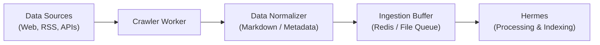

# Crawlers & Ingestion Engine

The **Crawlers** module is responsible for capturing raw information from external and personal data sources to feed into the **Second Brain**.

---

## 🎯 Purpose & Scope

Crawlers automatically extract, normalize, and deliver content to **Hermes** for processing, indexing, and storage. Examples of data sources include:
- Web articles & blog posts (read-it-later / bookmarks)
- RSS/Atom feeds
- Social media threads & saved posts
- Documentation, PDFs, and newsletters
- Personal notes and external APIs

---

## 🏗️ Architecture & Pipeline



---

## 📄 Standard Ingestion Document Schema

Every crawler emits structured items following this standard schema:

```json
{
  "id": "urn:source:unique-id",
  "source": "hackernews | rss | pocket | custom",
  "url": "https://example.com/article",
  "title": "Article Title",
  "author": "Author Name",
  "published_at": "2026-10-11T12:00:00Z",
  "fetched_at": "2026-10-11T15:30:00Z",
  "raw_content": "<p>Original HTML or text...</p>",
  "clean_content": "Extracted readable Markdown text...",
  "metadata": {
    "tags": ["ai", "productivity"],
    "language": "en"
  }
}
```

---

## 🚀 Adding a New Crawler

1. Create a dedicated directory under `crawlers/<source_name>/`.
2. Implement extraction logic following the standard document schema.
3. Add configuration to `.env` or the crawler configuration file.
4. Wire the crawler execution into the `schedulers/` module or run on-demand.

---

## 📦 Crawlers

| Crawler | What it captures |
| :--- | :--- |
| [`youtube-lists/`](youtube-lists/README.md) | All your YouTube playlists and their videos (metadata, comments, original-language transcripts) into SQLite + Markdown notes |
