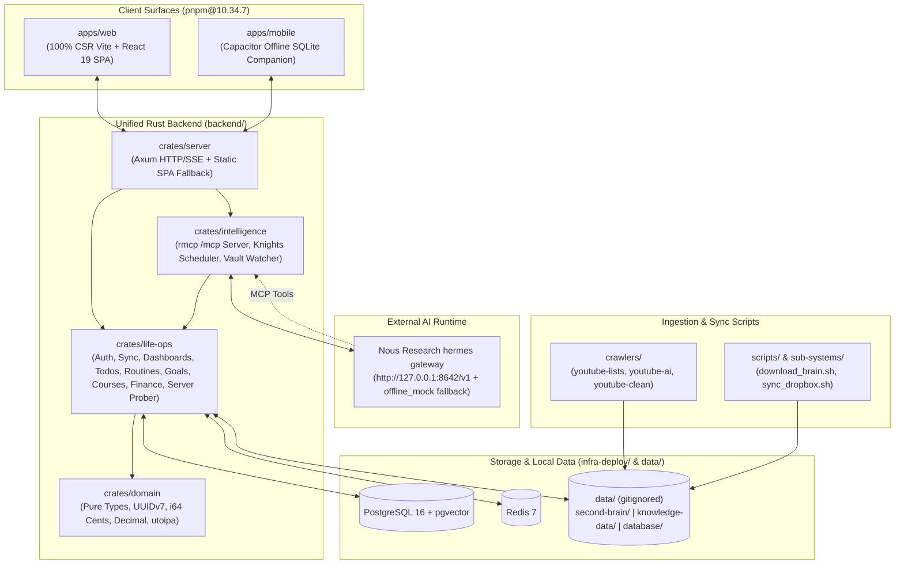

# System Architecture (`HERMES // OS`)

## 1. High-Level Topology

---

## 2. Component Interactions

1. **Unified Single-Origin Web & API Delivery**:
   - In production (`podman-compose.yml`), `hermes-server` serves `/api/*` REST + SSE endpoints, `/mcp` (`rmcp` Streamable HTTP), `/api/openapi.json`, and the static `apps/web/dist` bundle from a single Axum process on `:8080`. During active development, Vite HMR runs on `:5173` and proxies `/api` and `/mcp` to `:8080`.

2. **Life Operations & Offline-First Mobile Sync**:
   - `hermes-life-ops` persists canonical relational and vector state in **PostgreSQL 16 + `pgvector`** and caches transient state/quotes in **Redis 7**.
   - `apps/mobile` operates offline-first over local SQLite with `UUIDv7` primary keys and reconciles the 8 mobile tables (`projects`, `tasks`, `time_sessions`, `routines`, `routine_items`, `routine_logs`, `daily_checkins`, `companion_offline_phrases`) via `POST /api/sync/push` and `GET /api/sync/pull?since=last_seq` authenticated by `SHA-256`-hashed Personal Access Tokens (`plm_pat_...`).

3. **AI Orchestration & 3-Tier `/mcp` Autonomy**:
   - `hermes-intelligence` bridges Hermes Chat (`04`), Agent Studio Knights (`05`), and Frieren Companion (`06`) to Nous Research's `hermes gateway` (`HERMES_GATEWAY_URL`, forwarding `X-Hermes-Session-Key`), falling back cleanly to deterministic `offline_mock` responses when `:8642` is offline.
   - All 7 Life Ops domains (`dashboards`, `todos`, `routines`, `goals`, `courses`, `finance`, `servers`) are exposed via `/mcp` under three safety tiers: `READ`, `IMMEDIATE_UNDO`, and `REQUIRE_APPROVAL`.

4. **Read-Only Crawler Ingestion & Vault Export**:
   - Python `crawlers/` populate `data/database/youtube-lists.sqlite` and `data/knowledge-data/lists/youtube/`. Course Tracker (`10`) imports playlists strictly via `SQLITE_OPEN_READ_ONLY`, while Routine Check-ins & Weekly Reviews (`08`) export atomic Markdown notes into `data/second-brain/{Daily,Reviews}/`.
