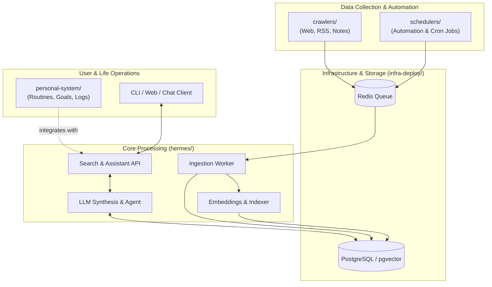

# System Architecture

## 1. High-Level Diagram

---

## 2. Component Interactions

1. **Ingestion Flow**:
   - `crawlers/` gather external content and push normalized documents into Redis or direct Hermes endpoints.
   - `schedulers/` run periodic routines, auto-player bots, and trigger crawler syncs.

2. **Processing & Indexing**:
   - `hermes/` receives raw documents, generates vector embeddings, extracts tags/summaries, and indexes them in PostgreSQL / pgvector.

3. **Querying & Retrieval**:
   - The user asks questions or looks up memories through Hermes.
   - Hermes retrieves relevant context via hybrid search (semantic + keyword) and synthesizes answers using LLMs.

4. **Personal Life Integration**:
   - `personal-system/` holds personal schemas (goals, habits, routines, journals) that Hermes can reference to assist with daily planning and habit tracking.
