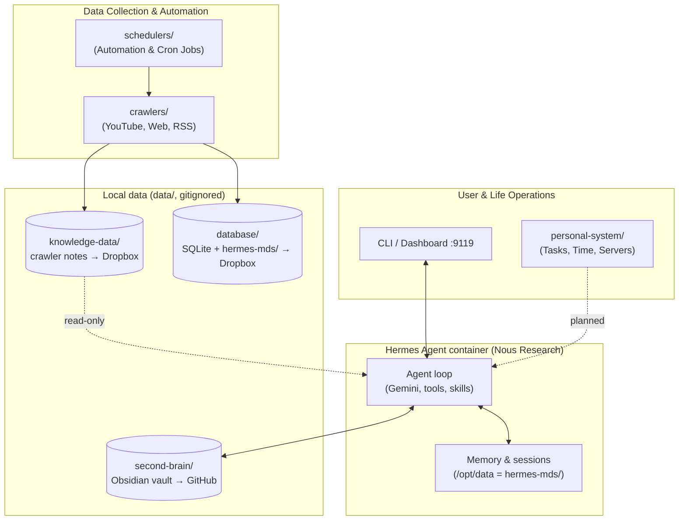

# System Architecture

## 1. High-Level Diagram

---

## 2. Component Interactions

1. **Ingestion Flow**:
   - `crawlers/` gather external content and write it into `data/`: SQLite databases in `data/database/` and Markdown notes in `data/knowledge-data/`.
   - `schedulers/` run periodic routines, auto-player bots, and trigger crawler syncs.

2. **Agent (Hermes)**:
   - The [Hermes Agent](https://github.com/NousResearch/hermes-agent) runs from its official image as the `hermes` service in `podman-compose.yml`, using Gemini as its model.
   - It reads and writes the Obsidian vault (`data/second-brain/`, mounted at `/vault`) and reads the crawler notes (`data/knowledge-data/`, mounted read-only at `/knowledge`). Nothing else on the host is mounted.
   - Its own state (config, memory, sessions, skills) lives in `data/database/hermes-mds/`.

3. **Persistence**:
   - The vault's Markdown notes are committed to GitHub manually.
   - `./scripts/sync_dropbox.sh` backs up everything else in `data/` (crawler notes, SQLite files, Hermes state) to Dropbox, and refuses to run while a crawler or the Hermes container is writing.

4. **Personal Life Integration**:
   - `personal-system/` holds tasks, time sessions and server health; connecting it to the agent is planned.
