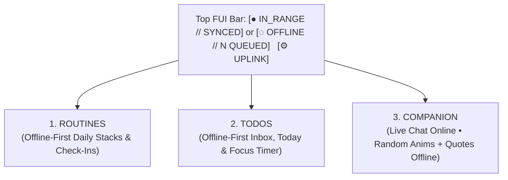
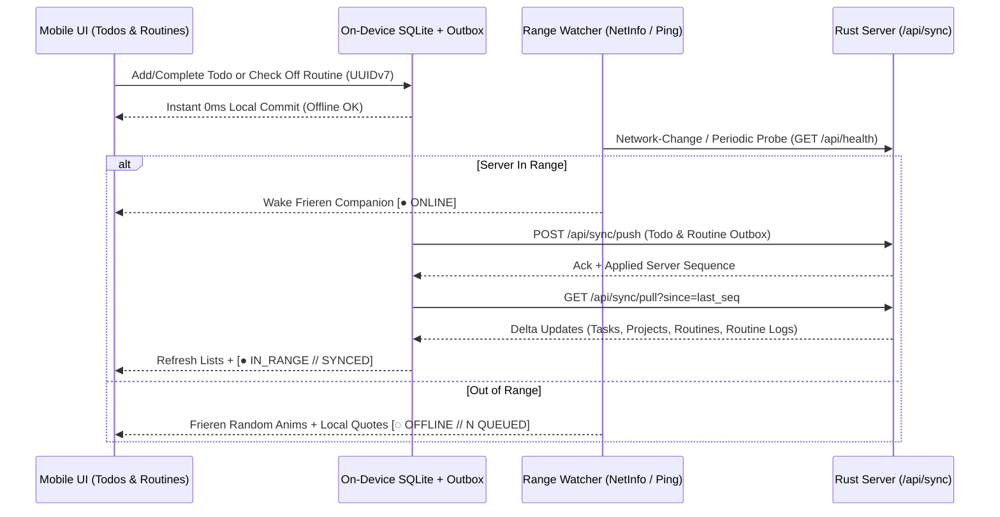

# 02 — Companion App (Strict Scope: Offline Todos & Routines + Online AI Companion)

> **Status**: Locked v1.0
> **Locked Runtime**: **Capacitor + Vite React CSR (`apps/mobile`, Android primary, iOS-compatible)** — 100% shared `packages/ui` (`REF-02` FUI + SVG HUD + Pixel-Art Frieren) + `@capacitor-community/sqlite` + OS Keychain SecureStorage + unrestricted raw LAN HTTP
> **Strict Boundary**:
> 1. **Todo List (`07`)** & **Routine Planning (`08`)** — **100% Offline-First** (local SQLite, auto-syncs when in range of the Rust server).
> 2. **AI Mastermind Companion (`06`)** — **Live AI Chat When Online + Autonomous Pixel Animations & Motivational Phrases When Offline**.
> 3. **All Other Modules (`03`, `04`, `05`, `09`, `10`, `11`)** — **Strictly Excluded (Web SPA Only)**.

---

## 1. Purpose & Disciplined Scope

The **Companion App** is an ultra-focused daily execution & habit field terminal—not a shrunk copy of the desktop OS.
- **Offline-First Core**: Managing your **Todo List** and checking off **Daily Routines** works anywhere with `0ms` latency against on-device SQLite and syncs automatically whenever your phone comes in range of your Rust server.
- **Dual-Mode Frieren Companion**:
  - **When Online (In Server Range)**: Full live streaming AI chat and tool control over your Rust backend.
  - **When Offline (Out of Range)**: Live LLM chat pauses, while **Frieren stays alive on screen cycling through random pixel-art animations and surfacing random motivational phrases** from an on-device curated list (on tap, screen open, or when completing Todos/Routines!).

---

## 2. Feature Matrix: Web SPA vs. Companion App

| Module | Web SPA (100% CSR) | Companion App Scope |
| :--- | :--- | :--- |
| **07. Todo List** | Full projects, `TERMINAL-I/O` flow (`REF-04`), dependency trees (`REF-05`) | **CORE (Offline-First)**: Quick Inbox Capture, Today & Upcoming lists, task completion, Focus Timer |
| **08. Routine Planning** | Routine designer, Ideal Week calendar, weekly review wizard | **CORE (Offline-First)**: Morning / Daytime / Shutdown / Evening checklists, streaks, daily check-in |
| **06. AI Mastermind** | Omnipresent pixel-art Frieren sprite + main system chat across screens | **HYBRID**: **Live AI Chat** when in server range; **Random Pixel Animations + Local Motivational Phrases** when offline |
| **03. Dashboard** | Full Life Stats telemetry, triptych/waffle charts, server health | *Excluded — Web SPA Only* |
| **04. Hermes Chat** | Multi-session workspace, sidebar, `REF-08` Thinking Orb, Vault inspector | *Excluded — Web SPA Only* |
| **05. Agent Studio** | Isometric Knight Arena (`REF-13`), prompt/tool forge, traces | *Excluded — Web SPA Only* |
| **09. Yearly Goals** | Orthogonal blueprint map (`REF-03`), OKR tree, drift analytics | *Excluded — Web SPA Only* |
| **10. Course Tracker** | Curriculum tree, YouTube sync, study notes, syllabus builder | *Excluded — Web SPA Only* |
| **11. Finance Operator** | Full ledger, waffle/hatched charts (`REF-07`), budgets, CSV/OFX import | *Excluded — Web SPA Only* |

---

## 3. App Navigation Structure (3 Tabs + Uplink Config)

### Online vs. Offline Behavior of Frieren (`COMPANION` & Mini-Sprite)
- **When `IN_RANGE` (`GET /api/health` + Auth OK)**:
  - Status flips to `[● UPLINK_ACTIVE // LIVE_COMPANION]`; full streaming LLM chat and server tool execution unlock immediately.
- **When `OFFLINE` (Out of Server Range)**:
  - **Random Pixel-Art Animation Rotation**: Frieren stays animated both on her dedicated tab (`REF-14` wind/stargazing loop) and as a mini-sprite on **Todos / Routines**, randomly cycling through local sprite loops (*flipping grimoire pages*, *wind-swept stargazing*, *casting blue-flower folk magic*, *sipping tea*, *cozy nod-off*, *rare Mimic chest gag*).
  - **Random Motivational Phrase Bank**: Tapping Frieren—or checking off a Routine / Todo offline—triggers a `REF-01` FUI speech bubble picking a non-repeating random line from a bundled/synced **Motivational & Deadpan Elf-Mage Phrase List** (e.g., *"Consistency is the most reliable magic."*, *"Uplink is out of range—handle the task in front of you first."*, *"Even a thousand-year journey is just today's routine repeated."*).
  - Free-text LLM input cleanly shows `[◌ OFFLINE_MODE — TAP FRIEREN FOR FIELD MOTIVATION]` until the Rust server comes back into range.

---

## 4. Offline-First SQLite & Range-Triggered Sync (Todos & Routines Only)

### Scoped Local SQLite Tables
Because Finance, Courses, Goals, and Hermes History are excluded from the mobile app, the on-device SQLite database stays tiny, fast, and trivial to reconcile:
- **Synced Tables**: `projects`, `tasks`, `time_sessions`, `routines`, `routine_items`, `routine_logs`, `daily_checkins`, `companion_offline_phrases` (built-in default bank + any custom motivational lines synced from your server), plus `sync_outbox` and `sync_meta` (`last_server_seq`).
- **Conflict Resolution**: Client-generated `UUIDv7` primary keys; append-only set union for `time_sessions` and new `tasks`; field-level Last-Write-Wins (`updated_at`) for task completions and `routine_logs`.
- **Cold-Launch & Sync Loader**: Uses the 3D Blaze-Orange Orbital Astrolabe (`REF-09`) on initial bootstrap and `REF-12`'s `WIFI` wave icon in the top FUI status bar during background delta syncs.

---

## 5. Server Uplink & Access Token Configuration (`SETTINGS // UPLINK_CONFIG`)

- [x] **Configurable Server IP / URL**:
  - Editable **`Primary Server URL`** accepting raw LAN IP + port (`http://192.168.1.42:8080`), Tailscale IP/MagicDNS (`http://100.x.y.z:8080`), or HTTPS URL (`https://life.vitorx86.dev`).
  - Optional **`Fallback Server URL`** (try fast LAN IP first; fall back to Tailscale/HTTPS URL when away).
- [x] **Configurable Personal Access Token (`Bearer` Auth)**:
  - Editable **`Access Token`** (`plm_pat_...`), stored encrypted in **iOS Keychain / Android Keystore** (`SecureStore`).
  - Sent via `Authorization: Bearer <ACCESS_TOKEN>` on `/api/sync/*` and live Companion SSE chat.
- [x] **`[⚡ TEST UPLINK]` & Optional Desktop QR Pairing**:
  - Pings `<SERVER_URL>/api/auth/verify` to display round-trip latency, token status, and outbox queue count; supports scanning a pairing QR code from the Desktop Web SPA to pre-fill URL + Token.

---

## 6. Locked Mobile Runtime (`Capacitor + Vite React CSR`)

- **Android Primary, iOS-Compatible**: Wraps a dedicated focused Vite React CSR mobile shell in **Capacitor** (`apps/mobile`), sharing 100% of `packages/ui` (`REF-02` Tactical FUI CSS, `REF-09`/`REF-12` SVG HUD loaders, and `<CompanionStage />` pixel-art Frieren animations) and `packages/api-client` with `apps/web`.
- **Native Capabilities**: Uses `@capacitor-community/sqlite` (offline DB + outbox), native SecureStorage (Keychain/Keystore encrypted Access Token), NetInfo range watcher, and native HTTP so plaintext local LAN IPs (`http://192.168.x.x:8080`) work with zero browser Mixed-Content blocks.
- **Uplink Config**: Supports **both** `Primary Server URL` (fast local LAN IP) + `Fallback Server URL` (Tailscale / WAN HTTPS) + `[⚡ TEST UPLINK]` + Desktop QR pairing.
