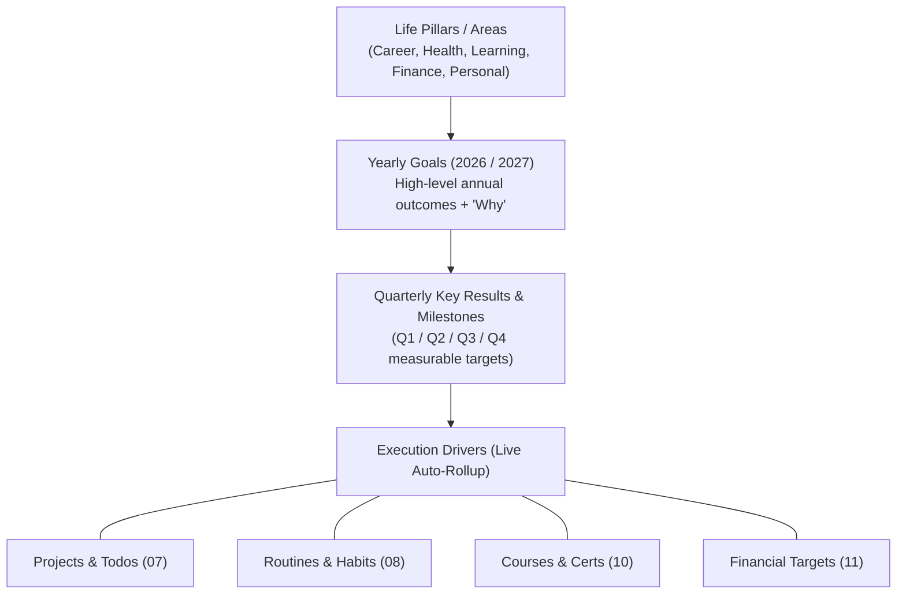

# 09 — Yearly Goals & Strategic Alignment

> **Status**: Locked v1.0
> **Platforms**: Web SPA Only (Excluded from Companion App)
> **Existing Repo Context**: Evolves `personal-system/goals/template.md` into a relational, live-tracked OKR & milestone system wired to Todos, Routines, Courses, and Finance.

---

## 1. Purpose

Static goal documents written in January are usually forgotten by February because they live disconnected from daily execution. The **Yearly Goals** module makes your annual objectives **first-class relational anchors** across the entire Life Manager: every Course, Project/Todo, Keystone Habit, and Savings Bucket can link upward to a Yearly Goal, calculating live progress and exposing strategic drift automatically.

---

## 2. Strategic Hierarchy

---

## 3. Core Functional Requirements

### 3.1. Yearly Theme & Pillar Architecture
- [x] **Annual Theme & North Star**: Define an overarching Yearly Theme (e.g., *"Year of Systems & Leverage"*), core anti-goals (*what I explicitly say NO to this year*), and 4–6 Life Pillars.
- [x] **Focus Cap Guardrail**: Soft warning if active Yearly Goals exceed a configurable limit (e.g., > 5–7 concurrent yearly goals) to prevent dilution.

### 3.2. Measurable Key Results (OKR Style) & Rollups
- [x] **4 Key Result Metric Types**:
  1. **Numeric Target**: e.g., *Read 12 technical books (`4 / 12`)*, *Run 500 km (`210 / 500`)*.
  2. **Milestone Checklist**: Weighted milestones summing to 100%.
  3. **Auto-Linked Module Rollup**: Progress computed live from linked entities:
     - *Course Completion %* from **Course Tracker (`10`)**
     - *Savings / Net Worth Target* from **Finance Operator (`11`)**
     - *Habit Consistency %* from **Routine Planning (`08`)**
     - *Project Tasks Completed %* from **Todo List (`07`)**
  4. **Binary Outcome**: Shipped / Achieved (`0%` or `100%`).
- [x] **Quarterly Breakdown (`Q1–Q4`)**: Slice annual goals into quarterly checkpoints so a 12-month goal always has an immediate 90-day finish line.

### 3.3. Pace Health & Drift Detection
- [x] **Expected vs. Actual Pace Indicator**: Compares `% Goal Progress` against `% of Year/Quarter Elapsed`:
  - 🟢 **On Track / Ahead** (within 10% of linear or milestone pace)
  - 🟡 **At Risk** (10–25% behind pace or 0 logged effort in 14 days)
  - 🔴 **Off Track** (>25% behind pace)
- [x] **Effort Investment Telemetry**: Shows total Deep Work + Study hours (`time_sessions`) invested in each Yearly Goal so you can see if a top-priority goal is starving for time.
- [x] **Monthly / Quarterly Check-In Log**: Confidence score (`1–10`), blockers, and pivot notes stored chronologically per goal.

### 3.4. Architectural Blueprint Visualization (`REF-03` — *Gradient Descent* Schematic)
*(Visual reference: [`assets/ref-03-yearly-goal-blueprint-map.jpg`](./assets/ref-03-yearly-goal-blueprint-map.jpg))*
- [x] **Interactive Orthogonal Facility Blueprint Canvas**:
  - Renders the entire year on a deep slate-blueprint sheet framed by a **double-ruled coordinate/binary margin**.
  - **Pillar Sectors ("Floors")**: Each Life Pillar (*Career & Systems*, *Health*, *Learning*, *Finance*, *Personal*) forms a labeled spatial zone on the blueprint.
  - **Room Nodes & `90°` Circuit Corridors**: Yearly Goals (`[G01]`), Quarterly Key Results (`[KR1.1]`), and linked Projects/Courses render as crisp rectangular schematic rooms connected by orthogonal `90°` solid/dashed lines (`──┬──┐`).
  - **North-Star Crimson/Orange Beacons (`●`)**: High-priority active objectives glow with bold circular beacon markers for immediate visual triage.
- [x] **Embedded Blueprint Tables & Legend**:
  - **Top-Left Title Block**: Year, Annual Theme, Revision, Days Elapsed (`Day 318 / 365`).
  - **Top-Right Quarterly Matrix Table (`Q1 | Q2 | Q3 | Q4`)**: Compact horizontal-ruled lookup table mapping quarters against pillar deliverables.
  - **Boxed `KEY` Legend & `STRATEGIST NOTES` Panel**: Persistent legend explaining node sizes/line styles plus your pinned annual rules & anti-goals.

---

## 4. Core Data Entities

- **`yearly_cycles`**: `year` (PK, e.g. `2027`), `theme`, `vision_md`, `anti_goals_md`, `status` (`planning | active | closed`).
- **`goals`**: `id`, `year`, `pillar` (`career | health | learning | finance | personal_project | relationships`), `title`, `why_motivation_md`, `status` (`not_started | in_progress | completed | paused | dropped`), `priority_rank`, `target_date`, `progress_pct`, `confidence_score`, `blueprint_pos` (JSONB nullable — optional manual pin override on `REF-03` grid), `created_at`, `updated_at`.
- **`goal_key_results`**: `id`, `goal_id`, `quarter` (`Q1 | Q2 | Q3 | Q4 | ANNUAL`), `title`, `metric_type` (`numeric | milestones | linked_course | linked_finance | linked_habit | linked_project`), `start_value`, `current_value`, `target_value`, `unit`, `linked_entity_id` (nullable), `weight`.
- **`goal_checkins`**: `id`, `goal_id`, `checkin_date`, `progress_snapshot`, `confidence_score`, `wins_md`, `blockers_md`, `next_steps_md`.

---

## 5. Locked Decisions

- **Cadence**: **Annual Goals + Quarterly OKRs (`Q1–Q4`)** within a focused 1-Year + Quarterly horizon.
- **`REF-03` Blueprint Layout Engine**: Auto-routed `90°` orthogonal facility blueprint grouped by Pillar Zones, with optional manual drag-to-pin coordinates (`blueprint_pos`) per node.
