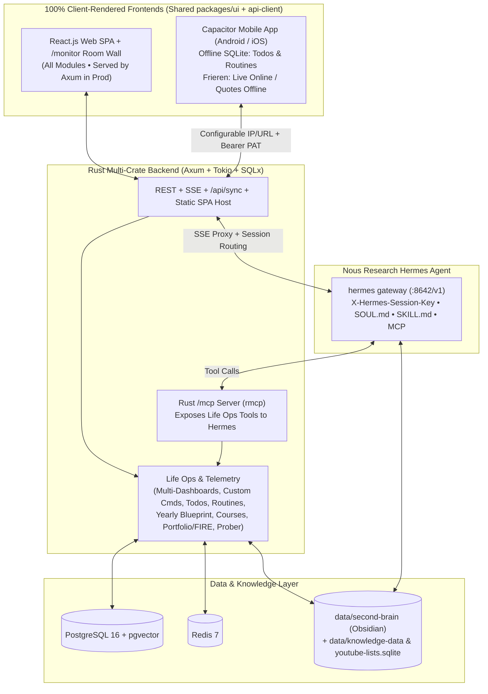

# Systems Requirements — `HERMES // OS` (Personal Life Manager)

> **Status**: **Locked v1.0 — Ready for Implementation Sign-Off** (Zero Code Written Yet)
> **System Stack**: **Rust** Multi-Crate Backend (`Axum` + `SQLx` + `/mcp`) + **`hermes gateway`** AI Engine + **100% CSR React SPA** (`Vite` + `packages/ui`) + **Capacitor Offline-First Mobile App**

This folder holds the finalized **v1.0 requirement specifications and 14-reference visual atlas** refined through our architectural & UX review.

---

## 1. System Ecosystem Map (`HERMES // OS`)

---

## 2. Locked v1.0 Specification Index

| Order | Specification File | Locked Scope Summary | Web SPA | Companion App | Status |
| :--- | :--- | :--- | :---: | :---: | :--- |
| **01** | [01-architecture-and-tech-stack.md](./01-architecture-and-tech-stack.md) | Multi-crate Rust (`Axum`+`SQLx`+`utoipa`+`/mcp`), `hermes gateway` bridge, Axum static SPA serving, replaces Go/Next.js, keeps Python `crawlers/` | Core | Core | `[x] Locked v1.0` |
| **02** | [02-companion-app.md](./02-companion-app.md) | Capacitor + React CSR (Android primary): Offline SQLite Todos & Routines, range sync, IP/Token config, Frieren Live Online / Random Anims & Quotes Offline | — | **Primary** | `[x] Locked v1.0` |
| **03** | [03-dashboard-life-stats.md](./03-dashboard-life-stats.md) | **Multi-Dashboard Auto-Cycling Room Monitor (`/monitor`)**: Widget Grid Builder + Custom CLI/HTTP/SQL/Hermes panels + Server Prober | **Core Wall** | Excluded | `[x] Locked v1.0` |
| **04** | [04-hermes-chat-interface.md](./04-hermes-chat-interface.md) | `hermes gateway` workspace, unified `X-Hermes-Session-Key` sidebar & `REF-08` 3D Geodesic Thinking Orb | Full | Excluded | `[x] Locked v1.0` |
| **05** | [05-agent-studio.md](./05-agent-studio.md) | **Isometric Tactical RPG Knight Arena (`REF-13`)**: Agents as Pixel Knights (`HP`/`EP` quotas, `/mcp` skill slots, cron/event queue) | Full | Excluded | `[x] Locked v1.0` |
| **06** | [06-ai-mastermind-companion.md](./06-ai-mastermind-companion.md) | Omnipresent Frieren pixel companion & main system chat (`REF-14` portrait + mini-sprite, tiered `[Undo]`/`[Approve]` safety) | Full | **Online Chat / Offline Quotes** | `[x] Locked v1.0` |
| **07** | [07-todo-list.md](./07-todo-list.md) | Standalone GTD/CODE tasks, `TERMINAL-I/O` project flow (`REF-04`), dependency arcs/trees (`REF-05`), Stopwatch + Pomodoro | Full | **Core (Offline)** | `[x] Locked v1.0` |
| **08** | [08-routine-planning.md](./08-routine-planning.md) | Day Profiles (`Workday/Weekend/MVD`), habit streaks, Weekly Review & auto-export to `data/second-brain/` Markdown | Full | **Core (Offline)** | `[x] Locked v1.0` |
| **09** | [09-yearly-goals.md](./09-yearly-goals.md) | Annual Goals + Quarterly OKRs (`Q1–Q4`) on auto-routed `90°` orthogonal `REF-03` facility blueprint | Full | Excluded | `[x] Locked v1.0` |
| **10** | [10-course-tracker.md](./10-course-tracker.md) | Courses + Playlists + Books + Certs, read-only import from `youtube-lists`/`youtube-ai` crawlers & 1-click Hermes Quiz | Full | Excluded | `[x] Locked v1.0` |
| **11** | [11-finance-operator.md](./11-finance-operator.md) | **Portfolio, Stock Watchlist (`BRL`+`USD` B3/US/Crypto), Monthly Investment/Spend Plan & Time-to-Retirement (FIRE) Engine** | Full | Excluded | `[x] Locked v1.0` |
| **12** | [12-design-references-and-inspirations.md](./12-design-references-and-inspirations.md) | Complete **14-Reference Master Atlas**: `REF-02` `0px` FUI law, Aperture Logo, HUD Loaders, Isometric Knights & Frieren Motion | Full | Shared `packages/ui` | `[x] Locked v1.0` |

---

## 3. Locked Implementation Roadmap

1. **Phase 1 — Rust Core + `REF-02` FUI Shell + Room Monitor Multi-Dashboards (`01`, `12`, `03`)**:
   - Cargo workspace (`server`, `domain`, `life-ops`, `intelligence` + `/mcp`), SQLx PostgreSQL migrations, `utoipa` OpenAPI -> `packages/api-client`, `packages/ui` (`REF-02` tokens, `REF-10` Aperture Logo, `REF-09` Orbital Boot Screen), Server Health Prober, Custom Command Widgets, and the **Auto-Cycling Fullscreen Room Monitor (`/monitor`)**.
2. **Phase 2 — Daily Execution + `hermes gateway` Bridge + Frieren & Hermes (`07`, `08`, `06`, `04`)**:
   - Todo List (`TERMINAL-I/O` flow, dependency arcs, Stopwatch/Pomodoro), Routine Planning (Day Profiles + Obsidian Markdown export), `hermes gateway` `:8642/v1` + Rust `/mcp` integration, **Pixel-Art Frieren Companion (`<CompanionStage />`)**, and **Hermes Sessions + `REF-08` Thinking Orb**.
3. **Phase 3 — Strategy, Learning, Portfolio/Retirement & Isometric Knights (`09`, `10`, `11`, `05`)**:
   - Yearly Goals Orthogonal Blueprint (`REF-03`), Course Tracker (`youtube-lists`/`youtube-ai` import + Hermes Quiz), **Finance Portfolio, Stock Watchlist & Retirement Simulator (`REF-07`)**, and **Agent Studio Isometric Knight Arena (`REF-13`)**.
4. **Phase 4 — Offline-First Capacitor Mobile Companion App (`02`)**:
   - Capacitor Android/iOS build reusing `packages/ui`, local SQLite + `UUIDv7` range-triggered `/api/sync/*` for Todos & Routines, configurable Primary/Fallback Server IP/URL & Access Token, and Dual-Mode Frieren (Live Chat Online / Random Pixel Animations & Motivational Quotes Offline).
