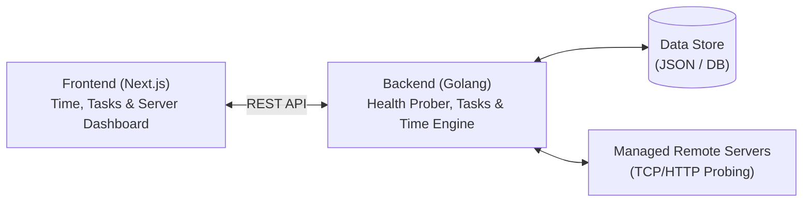

# Personal System

The **Personal System** is the operational core of your personal life management within the Second Brain. It includes an interactive full-stack management platform (Golang + Next.js) alongside personal routines, goals, and logs.

---

## 🏗️ Architecture



---

## 📁 Structure

- [`backend/`](file:///home/vitor/workspace/personal/personal-life-manager/personal-system/backend): High-performance Golang service managing tasks, time-tracking sessions, and server infrastructure health checks.
- [`frontend/`](file:///home/vitor/workspace/personal/personal-life-manager/personal-system/frontend): Next.js dashboard UI for administering time, tasks, and servers.
- [`goals/`](file:///home/vitor/workspace/personal/personal-life-manager/personal-system/goals): High-level aspirations, quarterly OKRs, and project milestones.
- [`routines/`](file:///home/vitor/workspace/personal/personal-life-manager/personal-system/routines): Daily, weekly, and monthly operational checklists and review templates.
- [`logs/`](file:///home/vitor/workspace/personal/personal-life-manager/personal-system/logs): Daily logs, reflections, decision journals, and habit records.

---

## 🚀 Running the Golang Backend

```bash
cd personal-system/backend
make run
```
Runs at `http://localhost:8080`. See [Backend Docs](file:///home/vitor/workspace/personal/personal-life-manager/personal-system/backend/README.md) for full API details.
